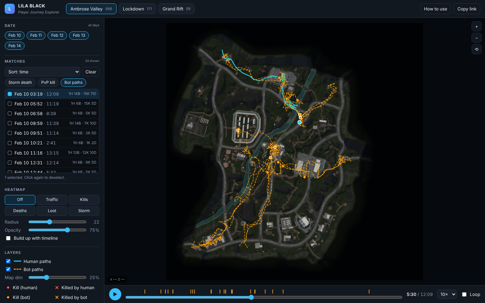
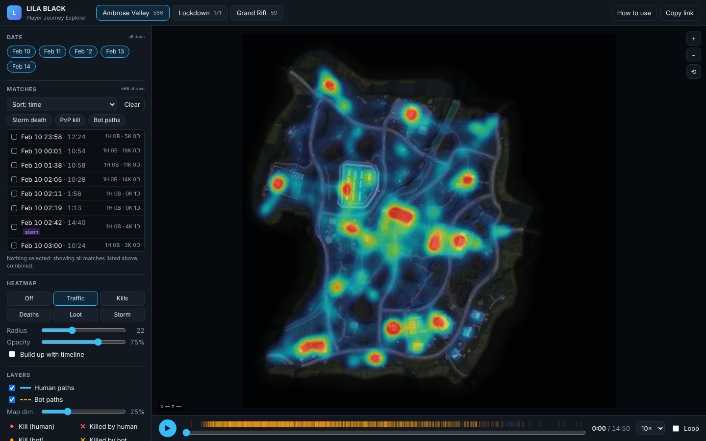
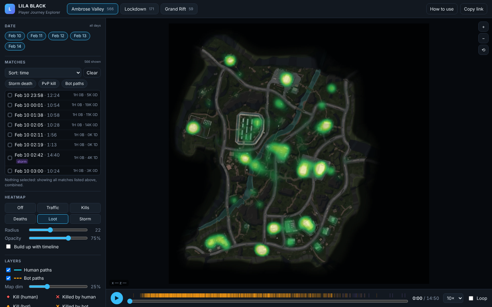
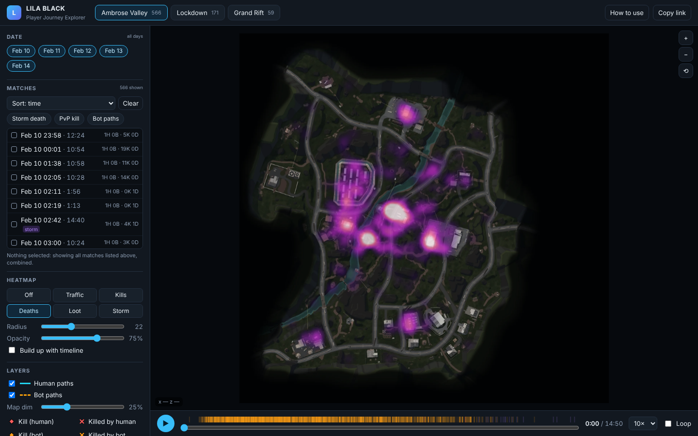

# Walkthrough

A written tour of every feature (screenshots in `docs/screenshots/`).

1. **Pick a map** – tabs at the top (match counts shown). Everything below adapts to the chosen map.
2. **Filter by date and match** – date chips (first click isolates a day, click more to add; deselect the last to reset). The match list shows start time (UTC), length, humans/bots, kills/deaths and `storm` / `PvP` tags. Sort by time, length, kills, deaths or bots, or use the quick filters *Storm death*, *PvP kill*, *Bot paths*. Click matches to select (multi-select). **No selection = all listed matches combined.**
3. **Watch a match** – press ▶ or Space. The head dot moves along each path, kills/deaths/loot appear as they happen, and ticks above the scrubber show combat/storm moments you can jump to. Speed 1–50×, loop on/off. With several matches selected they are overlaid from 0:00.
   
4. **Humans vs bots** – humans are solid bright lines with a ringed head (each human in a match gets its own colour); bots are thin dashed amber lines. Toggle either under *Layers*; hide single players in *Players in match*.
5. **Markers** – diamond = got a kill, ✕ = died; red = vs human, orange = vs bot; violet = storm death; green dot = loot. Click a legend entry to hide a type. Hover a marker for player, match time and world coordinates.
6. **Heatmaps** – Traffic / Kills / Deaths / Loot / Storm, with radius and opacity. *Build up with timeline* accumulates hotspots as the scrubber moves.
     
7. **Navigate** – scroll to zoom, drag to pan, ⟲ to reset. Cursor world (x, z) is shown bottom-left. *Map dim* makes overlays easier to read.
8. **Share** – *Copy link* stores map, days, selected matches and heatmap mode in the URL.
